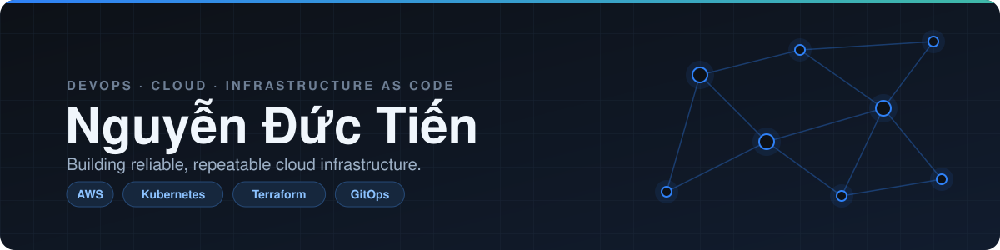

<picture>
  <source media="(prefers-color-scheme: dark)" srcset="assets/banner-dark.svg">
  <source media="(prefers-color-scheme: light)" srcset="assets/banner-light.svg">
  
</picture>

 

## About

I'm a **DevOps / Cloud Engineer**. I design and run infrastructure on AWS and Kubernetes, describe it as code, and ship it through GitOps pipelines with observability built in from day one.

- ☁️ Cloud networking, security and cost-aware architecture on **AWS**
- 🏗️ Infrastructure as Code with **Terraform** and **Pulumi (Go)**
- ⚙️ GitOps delivery with **Argo CD**, Helm and GitHub Actions (OIDC, no long-lived keys)
- 📈 Monitoring, SLOs and incident response for services on Kubernetes
- 🤖 Exploring AI tooling (MCP, Claude skills) to automate routine DevOps work

 

## Tech stack

**Cloud & IaC**&nbsp;

**Containers & GitOps**&nbsp;

**Observability**&nbsp;

**Languages & tools**&nbsp;

 

## Featured projects

<table>
  <tr>
    <td width="50%" valign="top">
      <h3><a href="https://github.com/nguyenductien-qnm/poc-infra">poc-infra</a></h3>
      One Pulumi (Go) codebase, three stacks (<code>dev</code>, <code>staging</code>, <code>prod</code>). Deployed through GitHub Actions with OIDC and read-only preview roles.  
      <b>Pulumi · Go · AWS · GitHub Actions</b>
    </td>
    <td width="50%" valign="top">
      <h3><a href="https://github.com/nguyenductien-qnm/capstone-phase-3">capstone-phase-3</a></h3>
      Took over a live multi-service e-commerce platform on Kubernetes and improved it across security, reliability, performance, cost and auditability.  
      <b>Kubernetes · Terraform · Helm · Argo CD</b>
    </td>
  </tr>
  <tr>
    <td width="50%" valign="top">
      <h3><a href="https://github.com/nguyenductien-qnm/argocd-observability-lab">argocd-observability-lab</a></h3>
      GitOps lab: Argo CD managing an application together with its observability stack.  
      <b>Argo CD · Kubernetes · Monitoring</b>
    </td>
    <td width="50%" valign="top">
      <h3><a href="https://github.com/nguyenductien-qnm/aws-vpc-peering-terraform">aws-vpc-peering-terraform</a></h3>
      Connects separate AWS VPCs with peering, routes and security rules, all written in Terraform.  
      <b>Terraform · AWS VPC · Networking</b>
    </td>
  </tr>
  <tr>
    <td width="50%" valign="top">
      <h3><a href="https://github.com/nguyenductien-qnm/CDO-09-Security">CDO-09-Security</a></h3>
      Detects sensitive data in S3 with Amazon Macie and sends instant alerts by email through EventBridge and SNS.  
      <b>Macie · EventBridge · SNS · S3</b>
    </td>
    <td width="50%" valign="top">
      <h3><a href="https://github.com/nguyenductien-qnm/jira-mcp">jira-mcp</a></h3>
      A Claude skill that logs Jira work to a team convention through the Atlassian MCP connector, with checks before anything is created.  
      <b>MCP · Claude skills · Jira</b>
    </td>
  </tr>
</table>

 

## Currently

- 🔭 Deepening Kubernetes operations: GitOps, SLOs and incident response
- 🌱 Learning how to make platform work repeatable with Infrastructure as Code and AI-assisted tooling

 

  

